# Banc d'Audit de Performance PostgreSQL (19,6M de Lignes)
### Suite de Mesure et d'Optimisation des Performances sur Données Réelles de Production

[](https://www.postgresql.org/)
[](https://rubyonrails.org/)
[](https://www.ruby-lang.org/)
[](LICENSE)

---

## 🎯 Résumé Exécutif

Au sein d'une application SaaS B2B multi-tenant exploitant **PostgreSQL 16** avec **19,6 millions de réponses** et **4,1 millions de sondages**, les tableaux de bord analytiques subissaient des lenteurs critiques entraînant des timeouts réguliers (**> 28 secondes** sur Heroku, déclenchant des erreurs `Rack::Timeout` et des dépassements de quota mémoire `Error R14`).

Face à cette saturation, la tentation initiale était spéculative : *« PostgreSQL a atteint ses limites physiques pour l'analytique ; il faut migrer vers une base de données colonnaire dédiée (ClickHouse) avec un pipeline d'ingestion asynchrone (ETL). »*

Ce dépôt présente la **démarche empirique d'audit** et le **banc de benchmark reproductible** qui ont permis d'invalider cette hypothèse. Grâce à une radiographie fine du moteur (`EXPLAIN (ANALYZE, BUFFERS)`), nous avons démontré que :
1. Les requêtes présentent une **très forte sélectivité (0,11 %)** : un cas d'usage où les arbres B-Tree relationnels sont intrinsèquement plus véloces que les balayages colonnaires.
2. Les timeouts étaient causés par deux anomalies logicielles précises : un mauvais ordonnancement des colonnes d'index et une sous-requête non dédoublonnée provoquant **134 262 passages dans une boucle imbriquée**.
3. L'ajout de **deux index composites ciblés** et d'un simple mot-clé (**`SELECT DISTINCT`**) a fait chuter les temps de réponse de **38 secondes à 1,39 seconde (-96 %)**, éliminant totalement le besoin d'une refonte d'infrastructure lourde.

---

## 📊 Tableau des Résultats Mesurés

Mesures relevées dans un environnement isolé reproduisant fidèlement les contraintes des dynos cloud (PostgreSQL 16, 2 vCPUs, 2 Go RAM, 512 Mo `/dev/shm`) en exécutant les **véritables services applicatifs Rails** sans aucun raccourci :

| Service Métier Réel | Baseline Initiale | Post-Optimisation | Gain Mesuré | Statut |
| :--- | :---: | :---: | :---: | :---: |
| **1. Évolution NPS** (`Dashboard::NpsEvolutionDataBuilder`) | 8 963 ms | **1 470 ms** | **-84 %** | 🟢 Résolu |
| **2. Évolution CSAT** (`Dashboard::CsatEvolutionDataBuilder`) | 9 834 ms | **2 005 ms** | **-80 %** | 🟢 Résolu |
| **3. Groupe Question - Tableau CSAT** (`DetailGroupeQuestion::CsatTableBuilder`) | 38 095 ms | **1 391 ms** | **-96 %** | 🟢 **Timeout Éliminé** |
| **4. Groupe Question - Liste Questions** (`DetailGroupeQuestion::QuestionsBuilder`) | 32 335 ms | **1 628 ms** | **-95 %** | 🟢 **Timeout Éliminé** |

*Les 4 services s'exécutent désormais tous sous la barre des 2 secondes, écartant tout risque de timeout.*

---

## 🔬 Analyse des Causes Racines

```mermaid
flowchart TD
    subgraph Pathologie1["1. Anomalie Algorithmique : 134 262 Boucles Imbriquées"]
        A1["WHERE customer_id IN (SELECT ci.customer_id ...)<br/>sans DISTINCT"] --> B1["Le planificateur choisit un Nested Loop<br/>Répète le scan de l'index 134 262 fois !"]
        B1 --> C1["Lit 71 467 blocs sur le disque en 9,7s à 20s"]
        C1 --> D1["CORRECTIF : Ajout de DISTINCT<br/>PostgreSQL bascule en Hash Join en 293 ms (-97%)"]
    end

    subgraph Pathologie2["2. Index Composite Manquant : 33 249 Lectures Disque"]
        A2["Filtre conjoint sur restaurant_id ET customer_id<br/>Seul restaurant_id était indexé"] --> B2["Bitmap Index Scan trouve 93 340 IDs<br/>Bitmap Heap Scan forcé de lire 33 249 blocs bruts sur disque"]
        B2 --> C2["Latence d'I/O disque : ~8,9 secondes"]
        C2 --> D2["CORRECTIF : Index B-Tree composite (restaurant_id, customer_id)<br/>Filtrage 100% mémoire vive en 1,4 seconde (-84%)"]
    end
```



### Preuve Mathématique de Non-Régression
La substitution de `IN (SELECT ...)` par `IN (SELECT DISTINCT ...)` a été vérifiée formellement sur l'ensemble des 19,6 millions de lignes :
* Nombre de questionnaires retournés par la requête originale : **22 826**
* Nombre de questionnaires retournés par la requête optimisée : **22 826**
* Différence ensembliste (`A EXCEPT B` et `B EXCEPT A`) : **0 ligne** (100 % d'intégrité métier, zéro doublon).

---

## 📁 Structure du Répertoire

```text
postgresql-performance-audit-harness/
├── README.md                           # Synthèse exécutive, résultats et analyse d'architecture
├── LICENSE                             # Licence MIT
├── scripts/
│   ├── benchmark_real_services.rb      # Harnais de test Rails avec interception ActiveSupport SQL
│   └── run_real_benchmark.sh           # Script d'exécution Shell autonome
├── sql/
│   ├── 01_nested_loop_case_study.sql   # Étude de cas 1 : Boucle imbriquée -> Hash Join (loops=134262)
│   └── 02_composite_index_case_study.sql# Étude de cas 2 : Bitmap Heap Scan -> Index Composite
├── results/
│   ├── 01_baseline_real_services.txt   # Journaux bruts de baseline (timeouts à 38s)
│   └── 02_optimized_real_services.txt  # Journaux post-optimisation (tous les services < 2s)
└── docs/
    ├── philosophie_et_demarche.md      # Mémo : Démarche empirique vs Refonte spéculative
    └── guide_lecture_explain.md        # Guide technique : Comment interpréter un EXPLAIN ANALYZE BUFFERS
```

---

## 🚀 Comment Relancer les Mesures

### Prérequis
* PostgreSQL 16 actif sur le port `5435` avec la base de données restaurée.
* Ruby 3.2.x avec les dépendances installées (`bundle install`).

### Exécution
```bash
# Cloner le dépôt
git clone https://github.com/romainchavalle/postgresql-performance-audit-harness.git
cd postgresql-performance-audit-harness

# Lancer le script de benchmark
./scripts/run_real_benchmark.sh
```

---

## 👤 Auteur & Contexte

* **Ingénieur :** Romain Chavalle
* **Cadre :** Audit Avancé de Performance & Scalabilité
* **Licence :** [MIT](LICENSE)
