# PostgreSQL Performance Audit Harness
### Real-world Scalability Audit & Benchmarking Suite on a 19.6M Rows Production Dataset

[](https://www.postgresql.org/)
[](https://rubyonrails.org/)
[](https://www.ruby-lang.org/)
[](LICENSE)

---

## 🎯 Executive Summary

In a high-throughput multi-tenant SaaS application operating on **PostgreSQL 16** with **19.6 million customer answers** and **4.1 million surveys**, analytics dashboards were suffering from severe timeouts (**> 28 seconds** on Heroku, triggering `Rack::Timeout` and memory threshold alerts `Error R14`).

Faced with this bottleneck, the instinctive architectural reaction was speculative: *“PostgreSQL cannot scale for analytics at this volume; we must migrate to a columnar OLAP database (ClickHouse) with an asynchronous ETL pipeline.”*

This repository presents the **evidence-based performance audit** and **reproducible benchmarking harness** that invalidated this assumption. Through scientific profiling (`EXPLAIN (ANALYZE, BUFFERS)`), we demonstrated that:
1. The queries exhibited a **high data selectivity (0.11%)**, an access pattern where relational B-Trees are fundamentally faster than columnar scans.
2. The timeouts were caused by two software pathologies: an index column order misalignment and an uncorrelated subquery causing **134,262 nested loop iterations**.
3. Applying **two targeted composite indexes** and **a single keyword change (`SELECT DISTINCT`)** collapsed response times from **38 seconds down to 1.39 seconds (-96%)**, entirely removing the need for a multi-month architectural overhaul.

---

## 📊 Consolidated Benchmark Results

Measured on an isolated, resource-constrained environment replicating cloud dyno limits (PostgreSQL 16, 2 vCPUs, 2 GB RAM, 512 MB `/dev/shm`) executing the **actual Rails application services** without shortcuts:

| Real-world Application Service | Initial Baseline | Post-Optimization | Time Reduction | Status |
| :--- | :---: | :---: | :---: | :---: |
| **1. NPS Evolution** (`Dashboard::NpsEvolutionDataBuilder`) | 8,963 ms | **1,470 ms** | **-84 %** | 🟢 Resolved |
| **2. CSAT Evolution** (`Dashboard::CsatEvolutionDataBuilder`) | 9,834 ms | **2,005 ms** | **-80 %** | 🟢 Resolved |
| **3. Question Group - CSAT Table** (`DetailGroupeQuestion::CsatTableBuilder`) | 38,095 ms | **1,391 ms** | **-96 %** | 🟢 **Timeout Eliminated** |
| **4. Question Group - Questions List** (`DetailGroupeQuestion::QuestionsBuilder`) | 32,335 ms | **1,628 ms** | **-95 %** | 🟢 **Timeout Eliminated** |

*All 4 services now execute comfortably under the 2-second threshold, completely eliminating the 28s timeout risk.*

---

## 🔬 Architectural Root Cause Analysis

```mermaid
flowchart TD
    subgraph Pathology1["1. Algorithmic Pathology : 134,262 Loop Iterations"]
        A1["WHERE customer_id IN (SELECT ci.customer_id ...)<br/>without DISTINCT"] --> B1["Planner chooses Nested Loop<br/>Repeats surveys index scan 134,262 times"]
        B1 --> C1["Reads 71,467 disk blocks in 9.7s to 20s"]
        C1 --> D1["FIX: Add DISTINCT<br/>PostgreSQL switches to in-memory Hash Join in 293 ms (-97%)"]
    end

    subgraph Pathology2["2. Missing Composite Index : 33,249 Heap Reads"]
        A2["Table filtered on restaurant_id AND customer_id<br/>Only single-column index existed"] --> B2["Bitmap Index Scan finds 93,340 IDs<br/>Bitmap Heap Scan forced to read 33,249 table blocks from disk"]
        B2 --> C2["Disk I/O latency: ~8.9 seconds"]
        C2 --> D2["FIX: Composite B-Tree (restaurant_id, customer_id)<br/>In-memory index traversal in 1.4 seconds (-84%)"]
    end
```



### Mathematical Proof of Equivalence
Replacing `IN (SELECT ...)` with `IN (SELECT DISTINCT ...)` was formally verified on the full 19.6M dataset:
* Original query survey count: **22,826**
* Optimized query survey count: **22,826**
* Set difference (`A EXCEPT B` and `B EXCEPT A`): **0 rows** (100% data integrity, zero duplication).

---

## 📁 Repository Structure

```text
postgresql-performance-audit-harness/
├── README.md                           # Executive summary, benchmark data, and architectural analysis
├── LICENSE                             # MIT License
├── scripts/
│   ├── benchmark_real_services.rb      # Standalone Rails harness with ActiveSupport SQL instrumentation
│   └── run_real_benchmark.sh           # Shell runner script for headless/CI execution
├── sql/
│   ├── 01_nested_loop_case_study.sql   # SQL Case Study 1: Nested Loop to Hash Join (loops=134262)
│   └── 02_composite_index_case_study.sql# SQL Case Study 2: Bitmap Heap Scan to Composite Index Scan
├── results/
│   ├── 01_baseline_real_services.txt   # Raw baseline measurement logs (showing 38s timeouts)
│   └── 02_optimized_real_services.txt  # Raw post-optimization logs (showing all services < 2.0s)
└── docs/
    ├── philosophie_et_demarche.md      # Methodological memo: Evidence-based vs Speculative Architecture
    └── guide_lecture_explain.md        # Technical guide: How to interpret EXPLAIN (ANALYZE, BUFFERS)
```

---

## 🚀 How to Run the Benchmark

### Prerequisites
* PostgreSQL 16 running on port `5435` with restored dataset.
* Ruby 3.2.x with application dependencies bundled (`bundle install`).

### Execution
```bash
# Clone the repository
git clone https://github.com/romainchavalle/postgresql-performance-audit-harness.git
cd postgresql-performance-audit-harness

# Execute the automated benchmark runner
./scripts/run_real_benchmark.sh
```

---

## 👤 Author & Context

* **Engineer:** Romain Chavalle
* **Project Context:** Advanced Performance & Scalability Audit
* **License:** [MIT](LICENSE)
