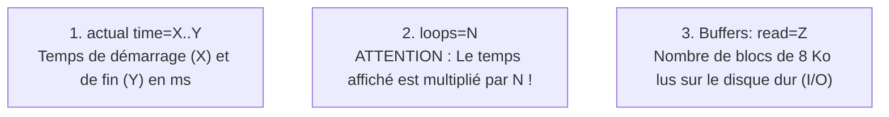

# Guide de Diagnostic PostgreSQL : Comment lire un EXPLAIN ANALYZE

Ce guide résume la méthode employée pour localiser les goulots d'étranglement de nos requêtes à l'aide des compteurs d'exécution de PostgreSQL.

---

## 1. Les 3 Indicateurs Clés

Un plan d'exécution PostgreSQL se lit de bas en haut :



$$\text{Temps réel total du nœud} = (\text{actual time fin} - \text{actual time début}) \times \mathbf{loops}$$

---

## 2. Étude de Cas n°1 : Le piège de la boucle `loops=134262`

```text
->  Nested Loop (actual time=0.080..9769.450 rows=22826 loops=1)
      ->  Index Scan using index_surveys_on_customer_id on surveys
          (actual time=0.015..0.065 rows=1 loops=134262)  <-- LE PIÈGE EST ICI
          Buffers: shared read=71467
```

* **Le piège :** `0.065 ms` semble négligeable. Mais répété $134\,262$ fois, cela représente **9,7 secondes** de calcul CPU et 71 000 lectures de blocs de disque !
* **La cause :** Une clause `WHERE surveys.customer_id IN (SELECT ci.customer_id ...)` non dédoublonnée qui incitait le planificateur à faire une boucle imbriquée unitaire.
* **La solution :** `SELECT DISTINCT ci.customer_id`. Le planificateur commute immédiatement sur un `Hash Join` calculé en 1 seule passe linéaire ($O(N)$), faisant chuter le temps à **293 ms**.

---

## 3. Étude de Cas n°2 : Le `Bitmap Heap Scan` (Index incomplet)

```text
->  Bitmap Heap Scan on surveys s (actual time=17.261..304.077 rows=93340 loops=1)
      Recheck Cond: (restaurant_id = ANY ('{...}'::bigint[]))
      Heap Blocks: exact=33249  <-- Lecture de 33 249 pages sur le disque !
      Buffers: shared hit=54 read=33336
```

* **Le piège :** L'index n'indexait que `restaurant_id`. PostgreSQL a dû aller lire 33 249 pages de données brutes sur le disque dur (`Heap`) pour inspecter la colonne `customer_id`.
* **La solution :** Un index composite sur `(restaurant_id, customer_id)`. PostgreSQL trouve toutes les informations nécessaires directement dans l'arbre B-Tree en mémoire vive, sans jamais toucher au disque dur.
