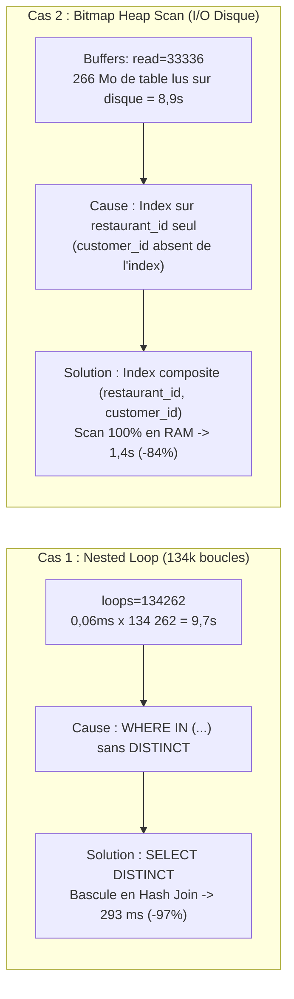

# Aide-Mémoire : Lire un EXPLAIN ANALYZE en 30 Secondes

---

## 1. La Règle d'Or des 3 Métriques

Pour trouver un goulot d'étranglement dans un plan PostgreSQL, regarder uniquement :

$$\text{Temps Réel d'un Nœud} = (\text{actual time fin} - \text{actual time début}) \times \mathbf{loops}$$

1. **`loops` :** Si `loops > 1 000`, le nœud est une boucle qui multiplie le temps.
2. **`Buffers: read=N` :** Nombre de blocs de 8 Ko lus sur le disque. Si $N > 10\,000$, la requête est bridée par les entrées/sorties disque (I/O).
3. **`Rows Removed by Filter` :** Lignes scannées puis jetées faute d'index adapté.

---

## 2. Les 2 Goulots Résolus lors de l'Audit

---

## 3. Synthèse des Nœuds Clés

| Nœud dans l'EXPLAIN | Diagnostic | Action Corrective |
| :--- | :--- | :--- |
| **`Seq Scan`** | Scan complet de la table sans index | Créer un index sur la colonne filtrée |
| **`Bitmap Heap Scan`** | L'index ne contient pas toutes les colonnes | Créer un index composite couvrant |
| **`Nested Loop` (loops élevé)** | Boucle répétée pour chaque ligne retournée | Ajouter un `DISTINCT` ou réécrire en `JOIN` pour forcer un `Hash Join` |
| **`Index Only Scan`** | **Idéal :** La donnée est 100% dans l'index en RAM | Aucune action, performance maximale |
