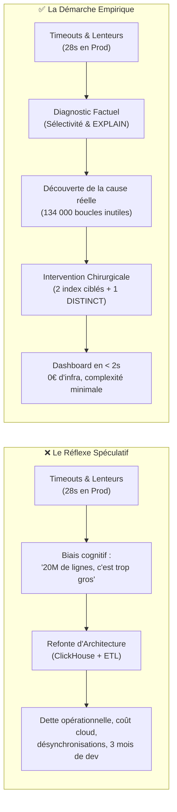

# Architecture & Performance : La Philosophie de l'Approche Empirique
## Pourquoi optimiser avant de reconstruire : Étude de cas sur 19,6M de lignes

---

> **Résumé exécutif**  
> Face à des timeouts sévères (> 28 secondes) et une volumétrie de près de 20 millions de réponses, la tentation naturelle d'une équipe d'ingénierie est de déclarer l'architecture relationnelle (PostgreSQL) obsolète et d'envisager une migration complexe vers un moteur analytique dédié (ClickHouse, Snowflake, pipeline ETL).  
> Ce document expose la démarche philosophique et méthodique menée : **refuser les suppositions intuitives, poser un diagnostic scientifique basé sur la sélectivité des données, et prouver par la mesure qu'une poignée d'interventions chirurgicales résout le problème sans introduire de dette opérationnelle.**

---

---

## 1. Le Piège de l'Architecture Spéculative

### Le symptôme n'est pas la maladie
Lorsqu'un tableau de bord met 30 secondes à charger ou plante en mémoire vive, l'expérience utilisateur est dégradée. Deux approches s'opposent :

1. **L'approche par conjecture (spéculative)** : Observer que la base de données grossit (20 millions d'enregistrements), en déduire que "le SGBD ne tient plus", et chercher un outil réputé rapide (base colonnaire, cache Redis massif, data warehouse).
2. **L'approche par la preuve (empirique)** : Ouvrir le capot du moteur, observer précisément chaque microseconde et chaque octet manipulé par le processeur et le disque, et comprendre *pourquoi* le moteur souffre.

Le piège classique réside dans la **confusion entre volume total et volume utile**.

---

## 2. Le Concept Pivot : La Sélectivité des Données

Pour déterminer si une architecture est réellement dépassée ou simplement mal exploitée, une seule métrique conceptuelle compte : **le taux de sélectivité**.

$$\text{Taux de Sélectivité} = \frac{\text{Nombre de lignes nécessaires pour la réponse}}{\text{Volume total de la table}}$$

* La table des réponses contient **19 600 000 lignes**.
* La requête n'a besoin que de **22 000 lignes**.
* Le taux de sélectivité est de **0,11 %**.

### Quand faut-il réellement changer d'architecture (OLAP / ClickHouse) ?
Une base analytique colonnaire (type ClickHouse) est conçue pour répondre à un besoin précis : **parcourir 80 % à 100 % d'une table gigantesque pour calculer une agrégation globale** (ex. moyenne de 500 millions de transactions sur 10 ans sans filtre). Dans ce cas précis, aucun index B-Tree traditionnel ne peut aider, et une architecture colonnaire s'impose.

Pour extraire 0,11 % de données ciblées, PostgreSQL est intrinsèquement l'un des moteurs les plus rapides au monde, capable d'exécuter cette tâche en quelques dizaines de millisecondes si l'aiguillage des index est adéquat.

---

## 3. Bilan Stratégique : Comparatif Décisionnel

| Dimension d'évaluation | Option A : Fuite en avant architecturale (ClickHouse / ETL) | Option B : Approche empirique ciblée (Optimisation PostgreSQL) |
| :--- | :--- | :--- |
| **Complexité du système** | **Très élevée** : Ajout d'une 2e base de données, pipeline de synchronisation, bus d'événements. | **Nulle** : L'infrastructure reste simple, monolithique et robuste. |
| **Consistance des données** | **Asynchrone (Eventual Consistency)** : Décalage entre données transactionnelles et reporting. | **Immédiate (ACID)** : Tout ajout est instantanément visible. |
| **Délai de mise en œuvre** | **2 à 3 mois** d'ingénierie (conception pipeline, gestion pannes, réécriture requêtes). | **Quelques jours** (création de 2 index ciblés, refactorisation d'une méthode de service). |
| **Coût financier (Run)** | **Élevé** : Facturation d'instances managées supplémentaires (ClickHouse Cloud, brokers). | **0 €** : Aucun surcoût d'infrastructure, réduction de l'empreinte mémoire existante. |
| **Résultat obtenu** | Dashboard sous les 2 secondes. | **Dashboard sous les 2 secondes.** |
